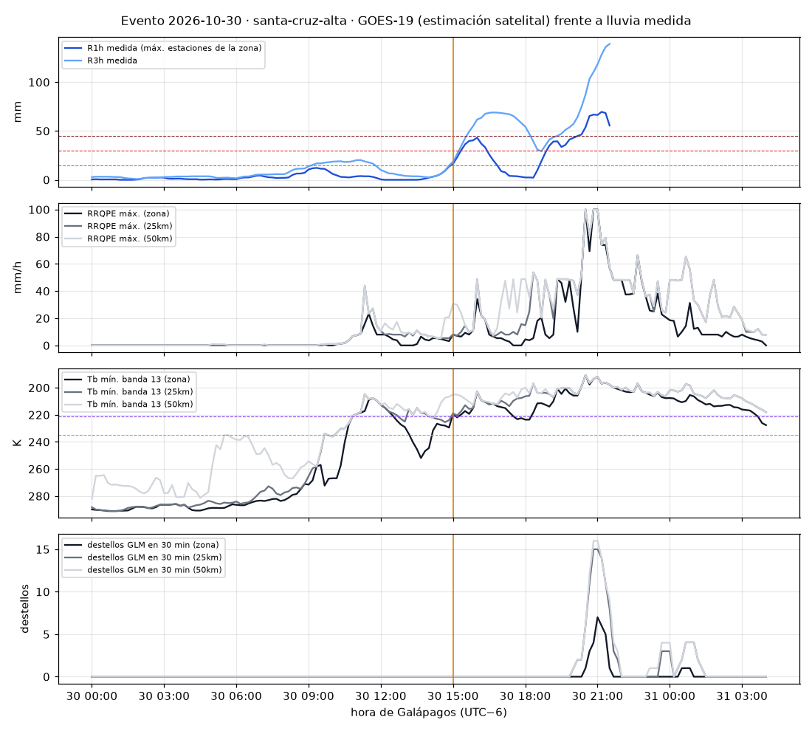
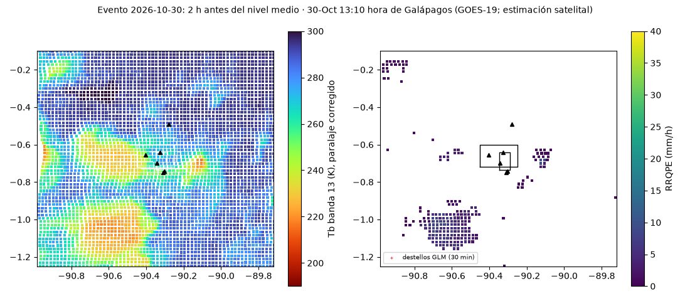
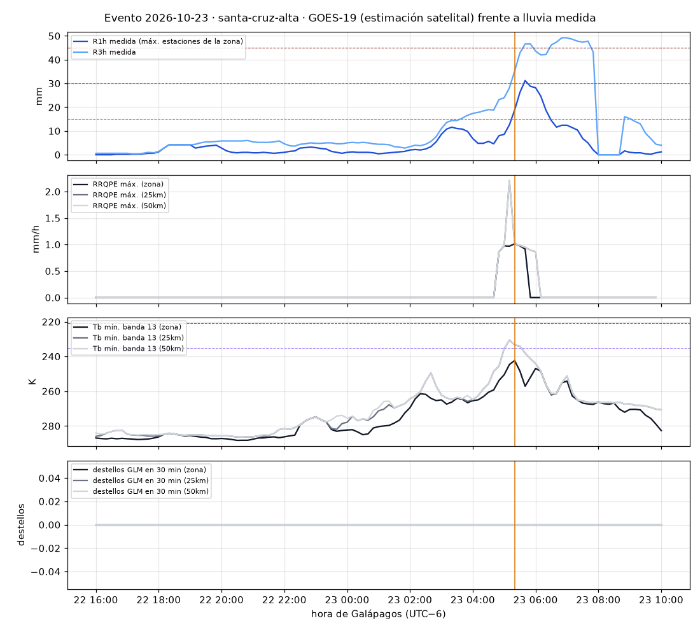

# GOES-19 frente a la lluvia medida en Santa Cruz: evaluación S0

*SOS Galápagos · 4-nov-2026 · preliminar · versión 2, tras la revisión independiente.* Scripts: `s0_extraer.py`, `s0_cribado.py` y `s0_evaluar.py`. Cifras completas: `resumen.json`. Figuras: `figuras/`.

> ⚠️ Es una **estimación satelital** evaluada con **un solo evento convectivo** (30-oct-2026) y con reglas **ajustadas a ese evento**. No es lluvia medida ni una alerta oficial. Las conclusiones pueden cambiar con el próximo evento.

## 1. Resumen

- **El satélite solo ve la lluvia convectiva** (topes de nube muy fríos). La lluvia orográfica de nubes bajas y medias no la ve: no detectó el 3-oct ni el 23-oct, ni 5 días de lluvia fuerte de mayo a octubre. **Que no haya señal no descarta lluvia fuerte.**
- **Un solo evento con adelanto útil: el 30-oct.**
  - Con la regla v1 y 3 h de persistencia, la vigilancia empezó **230 min antes** de que la regla de lluvia medida llegara a «medio» en La Cascada y **220 min antes** en la parte alta.
  - Descontando la latencia (~20 min: 10 hasta el bucket, hasta 5 del timer y hasta 5 de la exportación), quedan unos **3,5 h**.
  - Las reglas se ajustaron después de ver ese evento: la v0 no daba adelanto y se cambió por la v1.
- **Sin RRQPE también habría avisado**, una vez corregido el paralaje. Solo con los topes fríos de la banda 13, el adelanto fue de 190 min en La Cascada y 210 en la parte alta (unos 170–190 min descontando la latencia). Sin corregir el paralaje, La Cascada no avisaba con los topes fríos: dependía de RRQPE, que la NOAA tiene detenido desde el 2-nov.
- **2-nov:** avisó con 20 min en La Cascada, que la latencia anula. No avisó en la parte alta.
- **Octubre y 1–2-nov, por episodios** (v1 a 10 min con persistencia, §5.3):
  - se detectaron 2 de 4 episodios de lluvia intensa en La Cascada y 1 de 4 en la parte alta;
  - hubo 5 episodios de vigilancia sin lluvia intensa por zona: dos sin nada de lluvia (24 y 27-oct, 3–4 h cada uno) y tres con lluvia moderada (6–11 mm en 1 h) el 31-oct y el 1–2-nov;
  - la zona estuvo en vigilancia el ~4 % de octubre y el ~32 % del 1–2-nov.
- **Enero–abril:** la v1 estuvo activa 0 h en enero, 0–6 h en febrero, 26–30 h en marzo (~4 %) y **111–127 h en abril (15–18 % del mes)**, en 24–25 episodios por zona. Abril es la temporada convectiva. Sin estaciones en la parte alta (IERSE empieza el 23-abr), no se puede saber cuántos fueron reales: es la gran pregunta abierta para la fase B (§5.4).
- **Rayos (GLM):** casi no hay en Galápagos, y el 30-oct llegaron con el pico, no antes. **Salen de la regla.**
- **RRQPE:** en el evento del 30-oct acertó la hora pico en la parte alta (r = 0,8), pero subestimó la lluvia de 4 a 9 veces en el píxel. En la lluvia cálida dio 0. No sirve como dato de lluvia. Además está detenido desde el 2-nov, así que el panel muestra «incompleta» en lugar de «sin señal».
- **Propuesta (§6):** una vigilancia satelital aparte del nivel, que nunca lo baja ni lo sube, solo en las dos zonas evaluadas. Pronóstico y satélite se complementan: el consenso de modelos avisó del 23-oct con 4 días y el satélite ve llegar la convección en las horas previas.

## 2. Datos y método

- **Satélite.** GOES-19 (GOES-East, 75,2° O), disco completo cada 10 min, archivo abierto de la NOAA en AWS.
  - Banda 13 (CMIP, 10,3 µm): temperatura de brillo (Tb) ≈ temperatura del tope de nube.
  - RRQPE: tasa de lluvia estimada (mm/h).
  - GLM: destellos de rayos.
  - Solo se leyeron por rangos los recortes: Santa Cruz con ~55 km de margen.
- **Paralaje (corregido en esta versión).**
  - Desde 75,2° O, Galápagos se ve con un ángulo cenital de ~18°, y un tope de 14 km aparece ~4,5 km al oeste de su sitio.
  - Cada píxel se lleva a su posición real. La altura del tope sale de su Tb: (300 K − Tb) / 6,5 K/km, entre 0 y 16 km. El RRQPE usa la altura de la banda 13 del mismo barrido.
  - Importa porque La Cascada tiene unos 15 píxeles. `s0_evaluar.py --sin-paralaje` reproduce la versión 1.
- **Calidad.**
  - En el colector se descartan la banda 13 con DQF ≥ 2, los bits inválidos de RRQPE y los destellos con `flash_quality_flag` ≠ 0.
  - La caché de los tres eventos, de la muestra y de los cribados horarios se bajó antes de añadir esas máscaras: allí solo se descartó el valor de relleno. El refinamiento a 10 min de octubre y de enero–abril sí las aplica.
- **Lluvia medida.** Tabla `obs` de `clima.db`, leída en modo solo lectura: IERSE (Santa Cruz, cada 5 min), INAMHI M0191 (Puerto Ayora; horaria hasta el 2-nov) y Tempest (Punta Estrada). Para enero–abril, que no tiene IERSE (empieza el 23-abr), la lluvia diaria de la FCD en Puerto Ayora. Todas las horas en UTC.
- **Referencia: la regla de inundación v0.2 tal cual** (`recolector/inundacion.py`, sin persistencia), cada 10 min.
  - `t_medio` y `t_alto`: primer momento en «medio» y en «alto».
  - El satélite solo sirve si avisa **antes** de `t_medio`.
- **Zonas:** `la-cascada` (6 × 10 km) y `santa-cruz-alta` (22 × 13 km). Se solapan y comparten estaciones, así que **no son dos pruebas independientes**. San Cristóbal e Isabela no se evaluaron.
- **Regla v1** (`vigilancia.py`): RRQPE máxima ≥ 10 mm/h a menos de 25 km, **o** ≥ 10 % de la zona con Tb < 221 K. Persistencia: 3 h desde el último disparo.
- **Adelanto.**
  - «Con persistencia»: desde el inicio del episodio de vigilancia activo en `t_medio`.
  - «Efectivo»: lo mismo menos la latencia (~20 min).
  - Las tablas de señales sueltas usan, además, el criterio de la versión 1: unir disparos separados por huecos de hasta 60 min.
- **Periodos largos sin bajar 40 GB** (`s0_cribado.py`).
  - Se mira la banda 13 cada hora.
  - Alrededor de cada hora con Tb < 235 K a menos de 50 km de las zonas (±60 min), se baja la banda 13 y RRQPE cada 10 min.
  - La v1 solo puede dispararse con topes muy fríos (RRQPE también es infrarrojo), así que fuera de esas ventanas se supone que no se dispara.
  - Así se cubrió octubre–2-nov: 125 horas candidatas de 784, 17 ventanas, 148 h a 10 min. También enero–abril: 434 de 2 872, 53 ventanas, 519 h a 10 min.
- **Muestra de días de la versión 1:** 8 secos, 6 moderados y 5 de lluvia fuerte entre mayo y octubre, con ABI cada 30 min. Es poco exigente: solo 1 de 672 imágenes tenía topes < 221 K sobre las zonas. Se conserva como referencia (§5.1). Las pruebas que cuentan son las de §5.2–5.4.
- **Coste:** ~10 GB bajados con un enlace de ~1 MB/s desde Galápagos.

## 3. Los eventos

| Evento | Zona | R1h máx. | R3h máx. | «medio» | «alto» | Tb mín. (zona / 25 km) | RRQPE máx. (zona / 25 km) | Rayos (zona / 25 km) |
|---|---|---|---|---|---|---|---|---|
| 30-oct | La Cascada | 61,0 | 133,0 | 15:10 | 15:50 | 198 / 191 K | 55 / 100 mm/h | 3 / 36 |
| 30-oct | Santa Cruz alta | 69,6 | 139,2 | 15:00 | 15:20 | 191 / 191 K | 100 / 100 mm/h | 10 / 39 |
| 23-oct | La Cascada | 23,4 | 36,9 | 04:40 | — | 243 / 231 K | 1,0 / 2,2 mm/h | 0 / 0 |
| 23-oct | Santa Cruz alta | 31,2 | 49,2 | 05:20 | 05:40 | 242 / 231 K | 1,0 / 2,2 mm/h | 0 / 0 |
| 3-oct | ambas | 15,6 | 27,4 | 18:30 | — | 261–262 / 260–261 K | 0 / 0 | 0 / 0 |
| 1–2-nov | La Cascada | 21,1 | 30,1 | (2-nov 08:00)¹ | — | 213 / 205 K | 17 / 45 mm/h | sin GLM |
| 1–2-nov | Santa Cruz alta | 15,6 | 23,6 | 1-nov 19:50 | — | 211 / 205 K | 17 / 48 mm/h | sin GLM |

Horas de Galápagos (UTC−6). R1h y R3h en mm: el máximo de las estaciones válidas de la zona, con su peso. Paralaje corregido.

¹ La regla ya estaba en «medio» al empezar la ventana (por la lluvia de 24 h del 31-oct). Para el 1–2-nov vale el análisis por episodios (§5.3): el episodio intenso de La Cascada empezó el 2-nov a las 08:00.

Adelanto de la regla v1 frente al «medio» (min):

| Evento | Zona | Con persistencia | Efectivo (−20 min) | Solo banda 13 (sin RRQPE) |
|---|---|---|---|---|
| 30-oct | La Cascada | 230 | 210 | 190 |
| 30-oct | Santa Cruz alta | 220 | 200 | 210 |
| 23-oct y 3-oct | ambas | no avisó | — | — |
| 2-nov (episodio de las 08:00) | La Cascada | 20 | 0 | — |
| 1-nov, episodio de las 20:10 | Santa Cruz alta | no avisó | — | — |

### 30-oct: evento convectivo, detectado

- Los topes muy fríos aparecieron sobre la parte alta desde las ~10:30. Con el paralaje corregido, al menos 10 % de La Cascada tenía topes < 221 K desde las 12:00 y de la parte alta desde las 11:30. Después hubo una pausa de ~2 h con topes de 225–255 K.
- RRQPE ≥ 10 mm/h a menos de 25 km desde las 11:20.
- El primer chubasco fuerte de Santa Rosa (14–15 h, 43 mm en 1 h) cayó con topes de ~225 K.
- La lluvia máxima (19–21 h, 61–70 mm en 1 h) coincidió con el escudo frío más intenso (191–200 K) y con RRQPE saturado en su techo de 100 mm/h.
- **Rayos:** 36–39 destellos a menos de 25 km en todo el evento, todos entre las 20:30 y las 21:30, en pleno pico. Ninguno antes.
- Si se exige además lluvia en curso (R1h ≥ 5 mm), el adelanto desaparece.

### 23-oct y 3-oct: lluvia «cálida», invisible para el satélite

- **23-oct.** Santa Rosa midió 31 mm en 1 h. El tope más frío fue de 242–243 K sobre la zona (≈ −30 °C), RRQPE no pasó de 2 mm/h y no hubo rayos. Los topes se enfriaron poco a poco durante ~6 h y lo más frío coincidió con la lluvia.
- **3-oct.** Los Guayabillos midió 68 mm (15,6 mm en 1 h) con topes de 261–262 K, RRQPE en 0 y sin rayos.
- Es la lluvia orográfica de nubes bajas y medias. **El infrarrojo no puede verla.**
- Según la evaluación del pronóstico (`pronostico/`), el consenso de modelos sí daba «señal alta» para el 23-oct desde 4 días antes. **Pronóstico y satélite se complementan.**

### 1–2-nov

- La v1 se activó varias veces el 31-oct por la tarde, el 1-nov y el 2-nov, con topes de 205–213 K y RRQPE de hasta 45–48 mm/h a 25 km.
- Solo uno de esos episodios precedió a lluvia intensa: La Cascada el 2-nov, con 20 min de adelanto. Los demás acompañaron lluvias de 6–11 mm en 1 h (§5.3).
- RRQPE dejó de producirse el 2-nov a las 16:50 UTC, en mitad de la tarde.
- **Los Guayabillos está obstruido desde el 31-oct a las 02:00 UTC** (§5.5): no registra lluvia mientras Santa Rosa y el INAMHI miden hasta 15,7 mm/h. En esos días La Cascada se mide solo con el INAMHI y con Santa Rosa (peso 0,75), y la parte alta solo con Santa Rosa. Algún episodio «moderado» pudo ser intenso.

## 4. RRQPE frente a los pluviómetros (evento del 30-oct)

Media horaria de RRQPE en el píxel de la estación y máximo en 3 × 3 y 5 × 5 píxeles (~6 y ~10 km), frente a la lluvia horaria medida. Valores de la versión 1 (sin paralaje): la corrección mueve la lluvia unos 4–5 km y no cambia las conclusiones.

| Estación | Evento | Medido (mm) | RRQPE píxel / máx. 5×5 (mm) | Máx. 1 h medido / RRQPE 5×5 | Misma hora pico | r (horario, 5×5) |
|---|---|---|---|---|---|---|
| Santa Rosa | 30-oct | 216 | 47 / 104 | 66 / 56 | sí (02Z) | 0,81 |
| Los Guayabillos | 30-oct | 153 | 17 / 52 | 61 / 26 | sí (02Z) | 0,80 |
| Puerto Ayora INAMHI | 30-oct | 206 | 48 / 128 | 37 / 41 | no (06Z / 03Z) | 0,29 |
| Punta Estrada (Tempest) | 30-oct | 69 | 70 / 146 | 19 / 42 | no (06Z / 03Z) | 0,39 |
| Cerro Crocker | 30-oct | 5 | 31 / 93 | 0,8 / 47 | — | −0,07 |
| Militar | 30-oct | 2 | 12 / 33 | 0,8 / 7 | — | 0,41 |
| Santa Rosa | 23-oct | 81 | 0 / 0,3 | 28 / 0,3 | — | — |
| Los Guayabillos | 3-oct | 68 | 0 / 0 | 13 / 0 | — | — |

- **En este evento**, RRQPE acierta cuándo llueve más en la parte alta, pero subestima la cantidad: de 4 a 9 veces en el píxel y de 1,6 a 3 veces en el máximo 5×5 en Santa Rosa, Los Guayabillos y Puerto Ayora.
- Pone lluvia donde casi no llovió (Crocker, Militar).
- En Puerto Ayora el pico medido llegó 3 h después. Ojo: el respaldo del INAMHI es horario y su hora de origen es la continental.
- En la lluvia cálida, RRQPE da **cero**.
- **Riesgo operativo:** detenido desde el 2-nov a las 16:50 UTC, también en GOES-18.

## 5. Falsas alarmas y detección

### 5.1 Muestra de la versión 1 (mayo–octubre, ABI cada 30 min; poco exigente)

| Señal | Secos (8) | Moderados (6) | Lluvia fuerte (5) |
|---|---|---|---|
| v1, las dos zonas | 0 | 0 | 0 |
| RRQPE ≥ 10 mm/h a 50 km (parte alta) | 1 | 0 | 0 |
| ≥ 1 rayo en 30 min a 50 km | 0 | 1 | 0 |

La lista de días se eligió con una semilla fija, pero la regla de selección se escribió a mano. Solo 1 de 672 imágenes tenía topes < 221 K: la muestra apenas pone a prueba la señal, y por eso se añadieron §5.2–5.4.

### 5.2 Octubre, día a día (banda 13 cada hora)

Lluvia intensa medida: R1h ≥ 15 o R3h ≥ 30 mm en el día de Galápagos. Señal: ≥ 10 % de la zona con Tb < 221 K en alguna imagen horaria.

| Zona | Días | Aciertos | Fallos | Con señal sin lluvia intensa |
|---|---|---|---|---|
| La Cascada | 33 | 3 | 2 (3-oct, 23-oct) | 2 de 28 (24-oct, 1-nov) |
| Santa Cruz alta | 32 | 2 | 2 (3-oct, 23-oct) | 2 de 28 (24-oct, 2-nov) |

**Esta tabla mezcla episodios.** El «acierto» del 31-oct es la cola del 30-oct, y el 1 y el 2-nov forman un mismo episodio. La cuenta buena es la de §5.3.

### 5.3 Octubre–2-nov por episodios (v1 a 10 min, con persistencia)

Episodio de lluvia intensa: tramo con R1h ≥ 15 o R3h ≥ 30 mm (huecos de menos de 6 h dentro del mismo episodio). Detectado: había vigilancia entre 6 h antes de su inicio y su final.

| Zona | Episodios de lluvia intensa | Detectados | Con adelanto | Vigilancia sin lluvia intensa |
|---|---|---|---|---|
| La Cascada | 4 (3-oct, 23-oct, 30-oct, 2-nov) | 2 (30-oct: 230 min; 2-nov: 20 min) | 2 (1 útil tras la latencia) | 5 |
| Santa Cruz alta | 4 (3-oct, 23-oct, 30-oct, 2-nov) | 1 (30-oct: 220 min) | 1 | 5 |

Episodios de vigilancia sin lluvia intensa (hora de Galápagos):

| Inicio | Duración | Lluvia máx. en 1 h en el episodio |
|---|---|---|
| 24-oct 10:20–10:30 | ~4 h | 0 mm (las dos zonas) |
| 27-oct 03:50 | ~3 h | 0 mm (solo La Cascada) |
| 31-oct 14:10 | ~5 h | 7,6 mm (La Cascada); sin datos en la parte alta (estaciones cortadas) |
| 1-nov 05:50 | ~6,5 h | 7,2 mm (La Cascada) / 0,6 mm (parte alta) |
| 2-nov 06:30 (parte alta) y 14:20–14:30 | 3,5–5 h | 6,7–11 mm |

- Los días con convección cerca pero sin evento que señaló el revisor (11, 16 y 25-oct) **no dispararon** la v1.
- La zona estuvo en vigilancia **29,8 h en octubre** en La Cascada (4,0 % del mes) y 27,5 h en la parte alta (3,7 %). El 1–2-nov estuvo el 31–34 % del tiempo.
- De los 1 925 pasos con banda 13, 515 no tienen RRQPE: son casi todos imágenes horarias del cribado, que no lo traen, más el final del 2-nov.

### 5.4 Enero–abril de 2026 (v1 a 10 min en las ventanas del cribado)

Banda 13 cada hora en los cuatro meses (2 872 imágenes) y, en las 53 ventanas con topes < 235 K cerca, banda 13 y RRQPE cada 10 min. Son 5 415 pasos con banda 13; 2 311 sin RRQPE, casi todos horarios del cribado.

| Mes | Horas candidatas del cribado | Horas en vigilancia, La Cascada | Horas en vigilancia, parte alta |
|---|---|---|---|
| Enero | 0 | 0 (0 %) | 0 (0 %) |
| Febrero | 73 | 0 (0 %) | 6,3 (0,9 %) |
| Marzo | 98 | 25,8 (3,5 %) | 29,5 (4,0 %) |
| Abril | 263 | 110,8 (15,4 %) | 126,5 (17,6 %) |

- **Episodios:** 24 en La Cascada (5 en marzo y 19 en abril) y 25 en la parte alta, de 3 a 14 h cada uno. Abril estuvo en vigilancia casi a diario entre el 14 y el 27.
- **Contraste con la lluvia (solo diaria, en la costa).** No hay estaciones en la parte alta hasta el 23-abr. La única referencia es la lluvia diaria de la FCD en Puerto Ayora, al nivel del mar (privada, CC BY-NC-SA).
  - Hubo vigilancia en 18 días en La Cascada y 22 en la parte alta. De ellos, 5 no tienen dato de la FCD.
  - Con dato, solo 3–4 días pasaron de 10 mm en la costa (20-mar, 15-abr con 49 mm y 24-abr) y 1 pasó de 20 mm.
  - Al revés: de los 8 días con ≥ 10 mm en la FCD (ene–abr), la v1 estuvo activa en 3–4. Los demás, casi todos en febrero, fueron lluvia sin topes fríos.
- **Lectura.** En la temporada cálida la convección profunda cerca de Santa Cruz es frecuente, y con la v1 la zona estaría en vigilancia uno de cada seis días de abril. No se puede saber cuántos de esos episodios trajeron lluvia intensa a la parte alta. La costa no sirve para decirlo, porque la convección suele descargar arriba.
  - Es la razón principal para **no** pasar a la fase B y para que la vigilancia nunca suba el nivel.
  - También muestra por qué el texto debe decir «convección profunda cerca», y no «lluvia fuerte probable».

### 5.5 Estaciones dudosas

Horas en que una estación de Santa Cruz marca 0 mientras otra mide ≥ 5 mm (`resumen.json` → `estaciones_dudosas`):

- **Los Guayabillos:** su última hora con lluvia fue el **31-oct a las 02:00 UTC**. Desde entonces marca 0 con Santa Rosa o el INAMHI en 7–16 mm/h: 4 h el 1-nov, 6 h el 2-nov y 1 h el 3-nov. **Parece obstruido** (tal vez por el evento del 30-oct). El 23-oct también marcó 0 durante 5 h con Santa Rosa en 28 mm/h, aunque allí puede ser lluvia muy local.
- La regla v0.2 ya excluye una estación que marca 0 en 3 h si otra válida mide ≥ 10 mm. Con lluvias de 5–10 mm la excluye tarde o no la excluye.
- **Cerro Crocker** marca 0 en horas sueltas con lluvia abajo (garúa y lluvia muy local; no parece obstruido).

## 6. Propuesta para `recolector/inundacion.py`

**No se cambian los umbrales de la regla.** Con un solo evento convectivo con adelanto, la propuesta es prudente y por fases.

**Fase A, experimental (el colector, `satelite.json` y el panel ya lo hacen; falta llevarlo a `inundacion.py` si se quiere en la tarjeta de la zona):**

1. **Campo `vigilancia_satelital` por zona**, calculado con `satelite/vigilancia.evaluar()` sobre las series `goes` de las **últimas 3 h** en `clima.db`. `vigilancia.py` solo usa la biblioteca estándar; en el servidor está en `/opt/sosgalapagos-clima/satelite/`.
2. **Estados:**
   - `vigilancia`: alguna condición de la v1 en las últimas 3 h, con `ultimo_disparo` y `vigilancia_hasta`.
   - `sin señal`: ABI y RRQPE al día y ninguna condición.
   - `incompleta`: sin disparo, pero falta un producto (hoy RRQPE). **No es «sin señal».**
   - `sin datos`.
   - `sin_evaluar`: San Cristóbal e Isabela.
3. **El nivel no cambia.**
   - La tarjeta muestra, por ejemplo, «nivel bajo · convección profunda cerca (estimación satelital)», en un color neutro, nunca en ámbar.
   - Nunca baja el nivel: «sin señal» no dice nada de la lluvia cálida, y cada tarjeta debe decirlo.
   - No lo sube por sí sola.
4. **Silencio de las estaciones.** El 30-oct las estaciones de la parte alta dejaron de transmitir hacia las 21:45. Si callan y hay vigilancia satelital, la tarjeta debería decirlo de forma explícita, como refuerzo de la regla actual de «silencio en alerta = alarma» (sin cambiar sus umbrales).
5. **Mantenimiento.** Revisar Los Guayabillos (§5.5): una estación obstruida que marca 0 debilita a la vez la regla y esta evaluación.

**Fase B (solo con más evidencia):** que la vigilancia adelante el «medio».

- Mecanismo propuesto para entonces: v1 durante al menos 2 imágenes seguidas en una zona evaluada → «medio (por satélite)», con persistencia de 3 h y sin pasar de «medio».
- Requisitos:
  - al menos 3 eventos convectivos con adelanto, evaluados con reglas fijadas **antes** de verlos;
  - una temporada de falsas alarmas a 10 min con el colector en marcha;
  - zonas que no se solapen;
  - la revisión del especialista en gestión de riesgos.

**Siguientes pasos:** San Cristóbal, que tuvo lluvia intensa el 1 y el 2-nov según el GSC y aún no se ha evaluado; los próximos eventos, con la v1 congelada; y la tendencia de enfriamiento (Tb que baja más de 20 K en 1 h) como señal más temprana.

## 7. Operación en tiempo real

- **Latencia:** cada barrido ABI llega al bucket 9,7–10,3 min después de empezar. Con el timer (`*:2/5`) y la exportación del recolector (`*:0/5`), el dato llega al panel con 15–25 min de antigüedad.
- **Descarga por corrida en el servidor:** ~1,3 MB de banda 13, ~0,5 MB de RRQPE y ~2 MB de GLM por rangos, cada 10 min (~4 MB; ~17 GB al mes). No se guarda ningún netCDF.
- **Robustez:**
  - timeout de 15 s por petición y 3 intentos;
  - plazo de 170 s por corrida (el servicio, 240 s); lo que no cabe queda para la siguiente;
  - los fallos de lectura cuentan como error en `corrida.errores`.
- `satelite.json` (10–40 KB) viaja dentro de `estado.json` (clave `satelite`).
- Probado en local en tiempo real y repitiendo el 30-oct (`colector.py --ahora …`). **No se ha publicado.**

## 8. Limitaciones

- Un solo evento convectivo con adelanto. Las dos zonas se solapan. Todo en Santa Cruz.
- Reglas ajustadas a posteriori: v0 → v1 después de ver el 30-oct.
- Fuera de las ventanas del cribado se supone que la v1 no se dispara. Es razonable, porque exige topes muy fríos, pero no está medido.
- La altura del tope para el paralaje es una aproximación por Tb.
- Estaciones con cortes (30-oct desde las 21:45) y con obstrucción (Los Guayabillos desde el 31-oct).
- RRQPE tiene un techo de 100 mm/h y cortes de producción.
- La caché de los eventos, de la muestra y de los cribados horarios se bajó sin las máscaras DQF (solo sin el valor de relleno).
