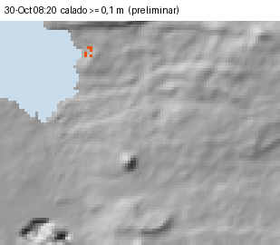

[[SALTO]]

# 4b. Modelo hidrodinámico 2D de lluvia sobre la malla

> **TOTALMENTE PRELIMINAR.** El modelo funciona sobre un DSM de 30 m que incluye techos y vegetación (±2–4 m) y no se ha calibrado: **no hay ni lluvia ni niveles medidos en San Cristóbal.** Los resultados indican **por dónde y en qué orden** circula el agua. Los calados y caudales son de orden de magnitud y no deben usarse para delimitar zonas ni para diseñar obras.

## 4b.1 Método

- **Ecuaciones.** Se usa el esquema inercial local de Bates, Horritt y Fewtrell (2010), escrito en numpy y numba (`scripts/25_modelo2d_san_cristobal.py`). No existía un núcleo previo para reutilizar.
  - El caudal por cada cara de celda combina presión, inercia local y fricción de Manning semiimplícita.
  - El paso de tiempo es adaptativo (CFL α = 0,7; máximo de 10 s).
  - En ladera empinada se aplican dos limitadores: uno de Froude (≤ 1) y otro de volumen, para que ninguna celda ceda más agua de la que tiene.
- **Lluvia sobre la malla.** Cada celda recibe la lluvia neta SCS-CN según su cobertura: natural CN 60, agrícola CN 76, poblado CN 90 (AMC II). La infiltración queda así distribuida.
- **Manning:** natural 0,08; agrícola 0,06; poblado 0,04; cauces D8 de ≥ 0,2 km², 0,045.
- **Dominio.** Comprende las cuencas que drenan a Puerto Baquerizo Moreno y a El Progreso (14,6 km²) más un margen de 150 m: en total, 18 km².
  - El mar y el borde del dominio absorben el agua.
  - El error del balance de masa es menor del 0,01 %.
- **Trazador.** La lluvia neta que cae en la cuenca de la quebrada del campus, aguas arriba del rellano (0,28 km²; sección 4.4), se marca y se sigue aguas abajo. Así se distingue el agua de la quebrada de la lluvia local.
- **Qué no representa el modelo:** red pluvial, alcantarillas, puentes, muros, cauces de menos de 30 m de ancho y transporte de sedimentos. En la ciudad, el agua «ve» manzanas de 30 m, no calles.

Tabla: Escenarios simulados (lluvia uniforme sobre el dominio).

| Escenario | Lluvia | Máx. 1 h | Suelo | Malla |
|---|---|---|---|---|
| (i) `scs100` | 100 mm en 24 h, SCS tipo II | 45 mm | AMC II | 30 m |
| (ii) `guayabillos` | **Medida el 30-oct en Los Guayabillos (Santa Cruz) y trasladada**: 178,8 mm en total, 95 mm acumulados a las 20:00 y fin del registro a las 21:25 | 63 mm (20–21 h) | AMC II | 30 m |
| (iii) `guayabillos_amc3` | Igual que (ii) | 63 mm | AMC III (húmedo) | 30 m |
| (iv) **`guayabillos_15m`** (principal) | Igual que (ii) | 63 mm | AMC II | 15 m (DSM remuestreado) |

El escenario (ii) es un **«qué pasaría si»**: es la lluvia de Santa Cruz, no la de San Cristóbal. Como la estación dejó de transmitir a las 21:25, en ese escenario **los picos coinciden con el final del registro y deben leerse como mínimos.**

## 4b.2 Resultados por encañada

Tabla: Caudal pico por sección (m³/s; hora de Galápagos en los escenarios con tormenta trasladada).

| Sección | (i) 100 mm | (ii) Trasladada | (iii) Húmedo | (iv) 15 m |
|---|---|---|---|---|
| Galápagos / Barrio Frío, desembocadura (S01) | 18 | 95 (21:30) | 127 | 100 |
| Galápagos, entrada a la ciudad (L01) | 4 | 23 | 28 | 19 |
| Divino Niño, salida (S02) | 7 | 16 | 23 | 18 |
| Alejandro Alvear, salida (S03) | 3 | 10 | 15 | 10 |
| Playa Mann (quebrada del campus), rellano | 0,2 | 2,4 | 3,5 | 2,3 |
| El Progreso, quebrada IGM (PRO-L01) | 0,6 | 15 | 17 | 15 |

- **Orden de llegada con la tormenta trasladada (iv).**
  - El Progreso es lo primero que se encharca: hay ≥ 0,3 m junto a la Escuela Carlos Darwin desde las 18:30.
  - En Barrio Frío el caudal supera los 5 m³/s a las 18:40 y los 20 m³/s a las 20:15. La desembocadura alcanza ≥ 0,3 m de calado a las 20:35.
  - **No hay una ventana de alerta de horas.** Las 2,5 h que pasan entre el inicio del pulso de las 18:00 y el desborde son un artefacto del hietograma trasladado, con dos pulsos. El desborde de la desembocadura (20:35) ocurre **dentro de la hora de máxima lluvia** (20–21 h). El margen real desde la lluvia intensa es, por tanto, **menor de 1 h**.
  - Además, el limitador de Froude (Fr ≤ 1) frena el flujo supercrítico de los tramos empinados. Por eso las horas de llegada del modelo están **sesgadas hacia tarde**, y el margen real puede ser aún menor.
- **Magnitud.**
  - En la desembocadura de Barrio Frío el calado es de 0,6–0,9 m y la velocidad de 1,2–3,2 m/s.
  - Junto al registro SNGR de El Manzanillo de 2019, sobre la Galápagos (tramo alto), el calado es de 0,5–0,7 m.
  - Con 100 mm, los mismos puntos se quedan en 0,3 m y 0,1 m.
- **Comparación con el método agregado (no es una validación).** Con 100 mm, el pico de Barrio Frío (18 m³/s) es parecido a la estimación SCS de la sección 4 (19 m³/s, con un rango de 9–58). Pero la coincidencia no valida nada: los dos métodos usan la misma lluvia de diseño, CN distintos (70 agregado frente a 60/76/90 distribuidos) y transformaciones distintas.
  - En las cuencas altas el 2D da caudales menores, porque llena primero las microdepresiones del DSM (copas y ruido).
  - En la quebrada de El Progreso, 0,6 m³/s frente a 1,7–12 m³/s.
  - Ese almacenamiento es en parte artificial, así que con poca lluvia el modelo **subestima** los caudales de la parte alta.

Tabla: Edificios de cada zona según el calado máximo en la celda de su centroide. Es un indicador: el DSM incluye techos.

| Zona (edificios) | Escenario | ≥ 0,1 m | ≥ 0,3 m | ≥ 0,5 m | ≥ 1 m |
|---|---|---|---|---|---|
| Puerto Baquerizo (2 988) | (i) 100 mm | 241 | 46 | 29 | 1 |
| | (iv) Trasladada, 15 m | 535 | 181 | 82 | 3 |
| El Progreso (206) | (i) 100 mm | 28 | 17 | 12 | 3 |
| | (iv) Trasladada, 15 m | 35 | 25 | 21 | 11 |

**El Progreso.** El agua se acumula en las depresiones del DSM descritas en la sección 4.3. En el vaso V01 llega a 5,5 m, una profundidad que es en buena parte un artefacto del DSM. Junto a la Escuela Carlos Darwin hay 0,3–0,8 m, según la malla. El modelo reproduce el **mecanismo** de los registros de la SNGR, el encharcamiento sin salida, pero sus calados dependen de depresiones de 1–5 m cuyo origen (terreno real o vegetación) no se conoce.

## 4b.3 ¿Entra el agua de la quebrada al campus USFQ / GSC?

Tabla: Agua que entra al «campus» del modelo (0,8 ha). Ese campus es la envolvente de las huellas de edificios universitarios de OSM (+15 m); en el DSM, esas huellas son techos. La entrada total incluye la lluvia de la propia ladera; el aporte de la quebrada se distingue con el trazador.

| | (i) 100 mm | (ii) Trasladada, 30 m | (iii) Húmedo | (iv) Trasladada, 15 m |
|---|---|---|---|---|
| Volumen total que entra (m³), con la lluvia de la ladera | 1 300 | 4 400 | 7 200 | 3 500 |
| Del cual, de la quebrada (m³) | 380 | 1 840 | 3 250 | 920 |
| Fracción del **volumen** de escorrentía de la quebrada que entra | 7 % | 10 % | 10 % | 5 % |
| Caudal máximo de entrada total (m³/s) | 0,23 | 0,70 | 0,98 | 0,60 |
| Del cual, de la quebrada (m³/s) | 0,02 | 0,31 | 0,47 | 0,18 |
| Calado máximo en el campus (m) | 0,02 | 0,04 | 0,05 | 0,05 |

**Respuesta**
- **Con la tormenta trasladada, sí entra agua de la quebrada, pero como desborde somero, no como cauce.**
  - En el rellano a ≈20 m*, la quebrada se reparte. En **volumen**, el 90–95 % sigue hacia Alvear (boca D8 al sur de Playa Mann) y un 5–10 % se derrama hacia el oeste y cruza el campus por la esquina noreste, junto a la Vía Universidad, hacia la costa.
  - Hay que separar dos cosas:
    - la **entrada total** al campus es de 0,6–1,0 m³/s (0,98 con AMC III) e incluye la lluvia de la propia ladera;
    - el **aporte de la quebrada** es de 0,18–0,47 m³/s.
  - Sobre el campus hay una lámina de 2–5 cm.
- **Con 100 mm, el aporte de la quebrada es pequeño en el modelo (0,02 m³/s), pero el modelo subestima la quebrada: no es concluyente.**
  - El 2D da 0,2 m³/s en el rellano, frente a 1,7–3,0 m³/s del SCS (sección 4.4): unas 10 veces menos.
  - La diferencia se debe a que el 2D llena las microdepresiones del DSM antes de que el agua corra.
- Esto concilia los resultados de la sección 4.4:
  - el D8 en UTM no entraba;
  - el D8 en la rejilla original sí entraba;
  - el 12–23 % de las realizaciones Monte Carlo cruzaban el campus.
  
  El 2D, que no obliga al agua a seguir una sola dirección, reparte el flujo entre ambas rutas.
- **Matiz importante.** Una malla de 15–30 m promedia la lámina sobre toda la celda. Si el desborde se encauza por la Vía Universidad o entre muros, el calado local será mayor. Como orden de magnitud, 0,5 m³/s por una calle de 8 m con un 5 % de pendiente circulan con ≈5 cm de calado a ≈1,4 m/s. No basta para inundar plantas bajas con umbral, pero sí para entrar por accesos a nivel y arrastrar sedimento.
- **Lo que decide la respuesta real** es la cota del rellano y de la Vía Universidad frente al campus, y si existe algún paso bajo la vía. Ninguna de las dos cosas se resuelve con este DSM: hace falta GNSS y una inspección en campo.

## 4b.4 Contraste con el Plan de Acción de la UGR

El Plan de Acción SC-4-09-2026 de la UGR del GAD San Cristóbal [R] da los nombres oficiales de las encañadas y los sectores de máxima prioridad. La correspondencia de nombres y la tabla completa están en la sección 4.6. Lo que aporta el modelo 2D es lo siguiente.

**Sectores que el 2D reproduce.** Con la tormenta trasladada y la malla de 15 m:
- **la playa de Barrio Frío:** 1,4 m de calado máximo;
- **el entorno del puente de la perimetral sobre la Galápagos (tramo alto)**, donde el plan sitúa el desborde de El Manzanillo de abril de 2026: 0,86 m y 10 edificios con ≥ 0,3 m;
- **La Planada:** 0,94 m y 15 edificios.

**San Francisco, Fragata y Estación Terrena:** sin ubicación fiable, no evaluados. Solo hay comercios homónimos en OSM.

Con 100 mm (malla de 30 m) solo destacan Barrio Frío y La Planada (0,5–0,8 m). El desborde de abril de 2026 junto al puente apunta, por tanto, a una lluvia mayor de 100 mm o a una obstrucción.

**Sectores que el 2D no reproduce.**
- El muro del Hospital Oskar Jandl (0,34 m) y la vía Jaime Roldós junto al Colegio Ignacio Hernández (0,19 m).
- El taponamiento de la boca de Playa de Oro y de las rejillas de Playa Mann.

Son procesos de calle, de obra y de sedimento que una malla de 15–30 m sin red pluvial no puede representar.

**Bifurcaciones (trazadores).** Para comprobar lo que dice el plan sobre la hidrografía se marcó el agua de la Galápagos aguas arriba de la ciudad y, en otra corrida, la de Divino Niño (escenarios `traz_galapagos_15m`, `traz_divinonino_15m` y `traz_galapagos_100mm_15m`).

Tabla: Por dónde sale al mar el agua marcada (porcentaje de su lluvia neta; el resto queda almacenado en el dominio).

| Agua marcada | Barrio Frío | Centro (muelles) | Playa de Oro (Divino Niño) | Boca D8 de Alvear (sur de Playa Mann) | Frente al campus |
|---|---|---|---|---|---|
| Galápagos, tormenta trasladada | 67 % | 0 % | 0,03 % | 0 % | 0 % |
| Galápagos, 100 mm | 48 % | 0 % | 0,02 % | 0 % | 0 % |
| Divino Niño, tormenta trasladada | 1,7 % | 0 % | 75 % | 0,9 % | 0 % |

**Respuesta**
- **El modelo no reproduce que Divino Niño «se separe de la Galápagos».** En el tramo donde podría ocurrir (una recta de 466 m entre ambos cauces, con ≈1,2 m* de resalte en el DSM; sección 4.6), el calado de la Galápagos es de 0,65 m con la tormenta trasladada. Harían falta ≈0,55 m más, y el resalte real probablemente es mayor que el del DSM.
- **El paso de Divino Niño a Alvear es marginal** (≈1 %).
- Ambas conexiones son topográficamente posibles dentro del error del DSM y con obstrucciones o rellenos. Que el modelo no las vea **no las descarta**: es una **hipótesis de confianza media-baja y consecuencia alta**. Si existen, la mancha inundable real de Divino Niño y Alvear sería mayor que la de este modelo.

## 4b.5 Limitaciones y confianza

- Sin calibración: no hay niveles, caudales ni marcas del evento en San Cristóbal.
- El DSM incluye techos y vegetación: crea obstáculos y depresiones falsas, y retiene agua en la parte alta.
- La lluvia de (ii)–(iv) procede de otra isla y está truncada a las 21:25. La lluvia real en San Cristóbal pudo ser muy distinta (sección 3).
- No hay red pluvial ni alcantarillas: en el centro urbano el modelo sobrestima el encharcamiento si los sumideros funcionan, y lo subestima si los pasos se obstruyen.
- Cambiar la malla de 30 a 15 m modifica los caudales en un ±20 % y los calados puntuales hasta en un factor 2–3 (El Progreso). Las conclusiones cualitativas no cambian.

Tabla: Nivel de confianza.

| Conclusión | Confianza |
|---|---|
| La Galápagos (Barrio Frío) concentra el mayor caudal y la desembocadura es el punto más expuesto | Media-alta |
| El 2D no reproduce la separación de Divino Niño desde la Galápagos que describe el plan | Media (es un resultado del modelo, no de la realidad) |
| Orden de llegada: El Progreso primero; Barrio Frío desborda dentro de la hora de máxima lluvia (margen < 1 h) | Media (horas sesgadas hacia tarde por el limitador de Froude) |
| Caudales y calados (orden de magnitud) | Baja |
| La quebrada del campus se reparte en el rellano y entra en el campus como una lámina de pocos centímetros (tormenta trasladada; con 100 mm, no concluyente) | Media-baja |
| Calados en El Progreso | Baja (dependen de las depresiones del DSM) |

**Archivos** (`datos/modelo2d/`, para cada escenario):
- `<escenario>_calado_max.tif` y `<escenario>_calado_max_clases.geojson`;
- `_velocidad_max.tif`, `_hv_max.tif` y `_hora_llegada_0.1m.tif` / `_0.3m.tif` (horas desde las 00:00);
- `_agua_quebrada_campus_max.tif` (trazador);
- `_series.csv` (cada 5 min: calado y velocidad en los puntos, caudal por sección y agua que entra al campus);
- `_cuadros_ciudad.npz` (cuadros cada 10 min, para la animación);
- `<escenario>_agua_marcada_max.tif` y `salidas_al_mar` en el resumen, para los escenarios con trazador (`traz_*`);
- `resumen_modelo2d.json`.
