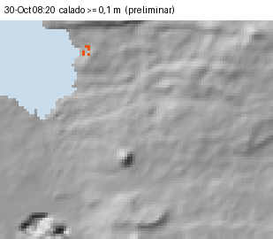

Intro: Un modelo hidrodinámico 2D reparte la lluvia sobre una malla del terreno y muestra por dónde y en qué orden corre el agua en Puerto Baquerizo Moreno y El Progreso. Aquí están los escenarios, los caudales por encañada, los edificios bajo el agua, lo que el modelo no ve y cuánto fiarse de cada resultado.

# Lo que muestra el modelo

El modelo dice **por dónde y en qué orden** circula el agua. No se ha calibrado: **no hay niveles ni caudales medidos en San Cristóbal, ni lluvia medida dentro de sus cuencas.** La lluvia del 31-oct sí se midió en la parte alta, fuera del dominio (ver [La lluvia](../lluvia/)), pero todavía no se ha pasado por el modelo. Trabaja sobre un DSM de 30 m que incluye techos y vegetación (±2–4 m). Los calados y caudales son de orden de magnitud y no sirven para delimitar zonas ni para diseñar obras.

- **La Galápagos (Barrio Frío) concentra el mayor caudal**, y su desembocadura es el punto más expuesto.
- **El Progreso es lo primero que se encharca**, en depresiones sin salida.
- **No hay una ventana de alerta de horas.** La desembocadura de Barrio Frío desborda dentro de la hora de máxima lluvia: el margen real desde la lluvia intensa es **menor de 1 h**, y puede ser aún menor.
- El modelo **no reproduce** que Divino Niño «se separe de la Galápagos», como describe el Plan de Acción de la UGR. Eso no descarta la conexión.

## Escenarios

Se simularon cuatro lluvias, uniformes sobre todo el dominio.

Tabla: Escenarios simulados (lluvia uniforme sobre el dominio).

| Escenario | Lluvia | Máx. 1 h | Suelo | Malla |
|---|---|---|---|---|
| (i) `scs100` | 100 mm en 24 h, SCS tipo II | 45 mm | AMC II | 30 m |
| (ii) `guayabillos` | **Medida el 30-oct en Los Guayabillos (Santa Cruz) y trasladada**: 178,8 mm en total, 95 mm acumulados a las 20:00 y fin del registro a las 21:25 | 63 mm (20–21 h) | AMC II | 30 m |
| (iii) `guayabillos_amc3` | Igual que (ii) | 63 mm | AMC III (húmedo) | 30 m |
| (iv) **`guayabillos_15m`** (principal) | Igual que (ii) | 63 mm | AMC II | 15 m (DSM remuestreado) |

El escenario (ii) es un **«qué pasaría si»**: es la lluvia de Santa Cruz, no la de San Cristóbal (ver [La lluvia](../lluvia/)). La estación dejó de transmitir a las 21:25, así que en ese escenario **los picos coinciden con el final del registro y se leen como mínimos.**

**¿A qué escenario se parece lo medido el 31-oct?** Las estaciones USFQ-GSC de la parte alta más cercanas al dominio, El Mirador y Cerro Alto, midieron 91–150 mm en el día, con 30–39 mm en la hora más intensa (08–10 h) [M]. En total es del orden de (i) o algo mayor, y menos que (ii); en intensidad, queda por debajo de los dos, más cerca de (i). El 30-oct ya habían caído 49–65 mm, así que el suelo se parecía más al de (iii). Es una comparación gruesa: **la simulación con la lluvia medida está pendiente.**

**¿Qué tan raros son estos escenarios?** No hay una serie medida larga en San Cristóbal, así que solo hay un orden de magnitud:
- en la serie medida de Puerto Ayora (FCD, 61 años), 100 mm en un día vuelven cada 4–5 años y 179 mm, cada 18–33 años;
- el reanálisis GAR corregido por su sesgo en la costa da ≈10 años para 100 mm.

El escenario (i) corresponde, por tanto, a un evento de **años**. El (ii), la tormenta de Santa Cruz trasladada, a uno de **decenas de años o más**. GAR no muestra que la parte alta de la isla tenga máximos diarios mayores que la costa, así que la lluvia uniforme es una hipótesis razonable para este nivel de análisis.

# Resultados por encañada

Tabla: Caudal pico por sección (m³/s; hora de Galápagos en los escenarios con tormenta trasladada).

| Sección | (i) 100 mm | (ii) Trasladada | (iii) Húmedo | (iv) 15 m |
|---|---|---|---|---|
| Galápagos / Barrio Frío, desembocadura (S01) | 18 | 95 (21:30) | 127 | 100 |
| Galápagos, entrada a la ciudad (L01) | 4 | 23 | 28 | 19 |
| Divino Niño, salida (S02) | 7 | 16 | 23 | 18 |
| Alejandro Alvear, salida (S03) | 3 | 10 | 15 | 10 |
| Playa Mann (quebrada del campus), rellano | 0,2 | 2,4 | 3,5 | 2,3 |
| El Progreso, quebrada IGM (PRO-L01) | 0,6 | 15 | 17 | 15 |

## Orden de llegada

Con la tormenta trasladada y la malla de 15 m (escenario iv):
- El Progreso es lo primero que se encharca: hay ≥ 0,3 m junto a la Escuela Carlos Darwin desde las 18:30.
- En Barrio Frío el caudal supera los 5 m³/s a las 18:40 y los 20 m³/s a las 20:15. La desembocadura alcanza ≥ 0,3 m de calado a las 20:35.
- Entre el inicio del pulso de las 18:00 y el desborde pasan 2,5 h, pero es un artefacto del hietograma trasladado, que tiene dos pulsos. El desborde de la desembocadura (20:35) ocurre **dentro de la hora de máxima lluvia** (20–21 h). Por eso el margen real desde la lluvia intensa es **menor de 1 h**.
- El limitador de Froude (Fr ≤ 1) frena el flujo rápido de los tramos empinados. Las horas de llegada del modelo están, por tanto, **sesgadas hacia tarde**, y el margen real puede ser aún menor.

## Magnitud

- En la desembocadura de Barrio Frío el calado es de 0,6–0,9 m y la velocidad, de 1,2–3,2 m/s.
- Junto al registro SNGR de El Manzanillo de 2019, sobre la Galápagos (tramo alto), el calado es de 0,5–0,7 m.
- Con 100 mm, esos mismos puntos se quedan en 0,3 m y 0,1 m.

## Comparación con el método agregado (no es una validación)

Con 100 mm, el pico de Barrio Frío (18 m³/s) se parece a la estimación SCS agregada (19 m³/s, con un rango de 9–58; ver [Encañadas](../encanadas/)). La coincidencia no valida nada: los dos métodos usan la misma lluvia de diseño, CN distintos (70 agregado frente a 60/76/90 distribuidos) y transformaciones distintas.
- En las cuencas altas el 2D da caudales menores, porque primero llena las microdepresiones del DSM (copas de árboles y ruido).
- En la quebrada de El Progreso da 0,6 m³/s, frente a 1,7–12 m³/s del método agregado.
- Ese almacenamiento es en parte artificial: con poca lluvia, el modelo **subestima** los caudales de la parte alta.

# Edificios bajo el agua

Se cuenta el calado máximo en la celda del centroide de cada edificio. Es un indicador, no un recuento de daños: el DSM incluye techos.

Tabla: Edificios de cada zona según el calado máximo en la celda de su centroide.

| Zona (edificios) | Escenario | ≥ 0,1 m | ≥ 0,3 m | ≥ 0,5 m | ≥ 1 m |
|---|---|---|---|---|---|
| Puerto Baquerizo (2 988) | (i) 100 mm | 241 | 46 | 29 | 1 |
| | (iv) Trasladada, 15 m | 535 | 181 | 82 | 3 |
| El Progreso (206) | (i) 100 mm | 28 | 17 | 12 | 3 |
| | (iv) Trasladada, 15 m | 35 | 25 | 21 | 11 |

## El Progreso

El agua se acumula en las depresiones del DSM (ver [El Progreso](../el-progreso/)). En el vaso V01 llega a 5,5 m, una profundidad que es en buena parte un artefacto del DSM. Junto a la Escuela Carlos Darwin hay 0,3–0,8 m, según la malla. El modelo reproduce el **mecanismo** de los registros de la SNGR, el encharcamiento sin salida. Pero sus calados dependen de depresiones de 1–5 m cuyo origen (terreno real o vegetación) no se conoce.

# El campus y el Plan de la UGR

## ¿Entra el agua de la quebrada al campus?

Un trazador marca la lluvia que cae en la quebrada del campus y la sigue aguas abajo. Con la tormenta trasladada, **sí entra agua de la quebrada al campus USFQ / GSC, pero como desborde somero, no como cauce**: en el rellano la quebrada se reparte, un 5–10 % del volumen cruza el campus, con 0,18–0,47 m³/s y una lámina de 2–5 cm. **Con 100 mm el resultado no es concluyente**, porque el 2D subestima la quebrada unas 10 veces. Las cifras, el reparto entre rutas y lo que queda por verificar en campo están en [Campus USFQ / Galapagos Science Center](../campus/).

## Contraste con el Plan de Acción de la UGR

El Plan de Acción SC-4-09-2026 de la UGR del GAD San Cristóbal da los nombres oficiales de las encañadas y sus sectores de máxima prioridad. Con la tormenta trasladada y la malla de 15 m, el 2D reproduce la playa de Barrio Frío (1,4 m de calado máximo), el entorno del puente de la perimetral sobre la Galápagos, tramo alto (0,86 m y 10 edificios con ≥ 0,3 m), y La Planada (0,94 m y 15 edificios). No reproduce los procesos de calle, obra y sedimento: el muro del hospital, la vía Jaime Roldós ni el taponamiento de bocas y rejillas.

Con trazadores, el modelo **no reproduce que Divino Niño «se separe de la Galápagos»**, y el paso de Divino Niño a Alvear es marginal (≈1 %). Que el modelo no vea esas conexiones **no las descarta**: siguen siendo una **hipótesis de confianza media-baja y consecuencia alta**. El detalle está en [El Plan de Acción de la UGR frente al análisis](../plan-ugr/).

# Método, limitaciones y confianza

## Método

- **Ecuaciones.** Esquema inercial local de Bates, Horritt y Fewtrell (2010), escrito en numpy y numba (`scripts/25_modelo2d_san_cristobal.py`). No existía un núcleo previo para reutilizar.
  - El caudal por cada cara de celda combina presión, inercia local y fricción de Manning semiimplícita.
  - El paso de tiempo es adaptativo (CFL α = 0,7; máximo de 10 s).
  - En ladera empinada actúan dos limitadores: uno de Froude (≤ 1) y otro de volumen, para que ninguna celda ceda más agua de la que tiene.
- **Lluvia sobre la malla.** Cada celda recibe la lluvia neta SCS-CN según su cobertura: natural CN 60, agrícola CN 76, poblado CN 90 (AMC II). Así la infiltración queda distribuida.
- **Manning:** natural 0,08; agrícola 0,06; poblado 0,04; cauces D8 de ≥ 0,2 km², 0,045.
- **Dominio.** Las cuencas que drenan a Puerto Baquerizo Moreno y a El Progreso (14,6 km²) más un margen de 150 m: en total, 18 km². El mar y el borde del dominio absorben el agua. El error del balance de masa es menor del 0,01 %.
- **Mar.** El agua sale libremente al mar, sin nivel de marea. Para las desembocaduras de playa (Barrio Frío, Playa de Oro) es un supuesto favorable. La mañana del 31-oct, el mar en Puerto Baquerizo Moreno estaba, según una estimación, entre +1,2 m (pleamar hacia las 06:00) y −0,4 m (bajamar hacia las 12:20) sobre el nivel medio [E]. No hay mareógrafo en la isla: el nivel se trasladó desde Puerto Ayora, con un error de ±0,1–0,2 m y ±30 min.
- **Trazador.** La lluvia neta que cae en la cuenca de la quebrada del campus, aguas arriba del rellano (0,28 km²), se marca y se sigue aguas abajo. Así se distingue el agua de la quebrada de la lluvia local. Otros trazadores marcan el agua de la Galápagos y la de Divino Niño (escenarios `traz_galapagos_15m`, `traz_divinonino_15m` y `traz_galapagos_100mm_15m`).
- **Qué no representa el modelo:** red pluvial, alcantarillas, puentes, muros, cauces de menos de 30 m de ancho y transporte de sedimentos. En la ciudad, el agua «ve» manzanas de 30 m, no calles.

## Limitaciones

- Sin calibración: no hay niveles, caudales ni marcas del evento en San Cristóbal.
- La lluvia medida el 31-oct (estaciones USFQ-GSC) está fuera del dominio y solo es horaria. No se ha simulado.
- El DSM incluye techos y vegetación: crea obstáculos y depresiones falsas, y retiene agua en la parte alta.
- La lluvia de los escenarios (ii) a (iv) viene de otra isla y está truncada a las 21:25. La lluvia real en San Cristóbal pudo ser muy distinta (ver [La lluvia](../lluvia/)).
- No hay red pluvial ni alcantarillas: en el centro urbano el modelo sobrestima el encharcamiento si los sumideros funcionan, y lo subestima si los pasos se obstruyen.
- Pasar la malla de 30 a 15 m cambia los caudales en un ±20 % y los calados puntuales hasta en un factor 2–3 (El Progreso). Las conclusiones cualitativas no cambian.

## Confianza

Tabla: Nivel de confianza.

| Conclusión | Confianza |
|---|---|
| La Galápagos (Barrio Frío) concentra el mayor caudal y la desembocadura es el punto más expuesto | Media-alta |
| El 2D no reproduce la separación de Divino Niño desde la Galápagos que describe el plan | Media (es un resultado del modelo, no de la realidad) |
| Orden de llegada: El Progreso primero; Barrio Frío desborda dentro de la hora de máxima lluvia (margen < 1 h) | Media (horas sesgadas hacia tarde por el limitador de Froude) |
| Caudales y calados (orden de magnitud) | Baja |
| La quebrada del campus se reparte en el rellano y entra en el campus como una lámina de pocos centímetros (tormenta trasladada; con 100 mm, no concluyente) | Media-baja |
| Calados en El Progreso | Baja (dependen de las depresiones del DSM) |

## Archivos

En `datos/modelo2d/`, para cada escenario:
- `<escenario>_calado_max.tif` y `<escenario>_calado_max_clases.geojson`;
- `_velocidad_max.tif`, `_hv_max.tif` y `_hora_llegada_0.1m.tif` / `_0.3m.tif` (horas desde las 00:00);
- `_agua_quebrada_campus_max.tif` (trazador);
- `_series.csv` (cada 5 min: calado y velocidad en los puntos, caudal por sección y agua que entra al campus);
- `_cuadros_ciudad.npz` (cuadros cada 10 min, para la animación);
- `<escenario>_agua_marcada_max.tif` y `salidas_al_mar` en el resumen, para los escenarios con trazador (`traz_*`);
- `resumen_modelo2d.json`.
