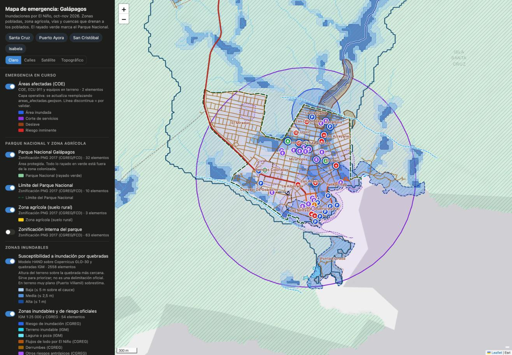

# Mapas de la emergencia: Galápagos 2026

Capas cartográficas para coordinar la respuesta a las **inundaciones por El Niño** (oct–nov 2026) en **Santa Cruz, San Cristóbal e Isabela**: zonas inundables, quebradas y cuencas, Parque Nacional y zona agrícola, zonas pobladas, vías y puntos clave.

Esta carpeta es el **entregable final**. Tiene todo lo necesario para ver los mapas, usarlos en otro sistema o pedir al equipo de ResponseGrid que los incorpore.



## Qué hay aquí

| Carpeta o archivo | Para qué sirve |
|---|---|
| `ver-mapa.sh` | Abre el visor en el navegador (`./ver-mapa.sh`, o doble clic desde la terminal). |
| `visor/` | Visor web independiente: no necesita ResponseGrid ni internet, salvo para los mapas base. |
| `datos/` | **Los mapas listos**: 23 capas GeoJSON, los PNG de relieve y el manifiesto `capas.json`. Son 13 MB. |
| `capturas/` | Imágenes de cada isla y del mapa ya integrado en ResponseGrid. |
| `documentacion/01-catalogo-de-capas.md` | Cada capa: qué es, de dónde sale, cuántos elementos tiene y qué campos. |
| `documentacion/02-metodologia.md` | Cómo se calcularon la susceptibilidad, las cuencas, la costa baja y la exposición, y sus límites. |
| `documentacion/03-fuentes-y-licencias.md` | Fuentes oficiales, fecha de los datos, licencias y atribuciones obligatorias. |
| `documentacion/04-especificacion-capas-json.md` | Formato técnico del manifiesto `capas.json`. |
| `documentacion/05-como-actualizar.md` | Cómo cambiar una capa, por ejemplo las áreas afectadas del COE, y regenerar todo. |
| `para-responsegrid/` | **Paquete para pedir al equipo de ResponseGrid que integre los mapas**: propuesta lista para pegar, guía técnica, parche y código. |

## Ver los mapas

```bash
cd mapas-galapagos
./ver-mapa.sh          # abre http://127.0.0.1:8765/visor/  (Ctrl+C para cerrar)
```

En el panel izquierdo:
- se encienden y apagan las capas, cada una con su leyenda;
- los botones **Santa Cruz, Puerto Ayora, San Cristóbal e Isabela** encuadran cada zona;
- se puede cambiar el mapa base (claro, calles, satélite o topográfico);
- al hacer clic sobre cualquier elemento se abre su ficha.

## Las capas en resumen

| Grupo | Capas | Fuente |
|---|---|---|
| **Emergencia en curso** | Áreas afectadas (inundación, corte de servicios, deslave, riesgo); discontinua = por validar | COE / equipos en terreno |
| **Parque Nacional y zona agrícola** | Parque Nacional (rayado verde), límite del parque, zona agrícola | Zonificación PNG 2017 (CGREG/FCD) |
| **Zonas inundables** | Susceptibilidad a inundación por quebradas (alta, media, baja); zonas inundables oficiales (riesgo de inundación y flujos de lodo por El Niño del CGREG, terreno inundable del IGM); costa baja; tsunami | Modelo, CGREG, IGM, INOCAR |
| **Quebradas y drenaje** | Cuencas completas que drenan a cada poblado, quebradas del IGM 1:25 000, cauces adicionales detectados en el relieve, franja de 20 m, subcuencas | IGM, CGREG, modelo |
| **Zonas pobladas** | Límite urbano, barrios, población estimada por manzana | IGM, CGREG, INEC + SNGR |
| **Vías y evacuación** | Vías por jerarquía, rutas de evacuación por tsunami | OSM, SNGR |
| **Puntos clave** | Salud pública, albergues, zonas seguras, sirenas, colegios, policía y bomberos; agua, energía y transporte; alojamiento y comercio | MSP, SNGR, MINEDUC, IGM, OSM |
| **Relieve** | Relieve sombreado, curvas cada 10 m, pendientes | Copernicus GLO-30 |

**Área cubierta:** toda la zona agrícola y urbana, las **cuencas completas** que drenan hacia cada poblado (aunque suban al parque), 500 m alrededor de las zonas pobladas y 300 m alrededor de las vías. El resto del Parque Nacional aparece rayado en verde.

**Exposición estimada** (`datos/resumen_exposicion.json`):

| | Santa Cruz | San Cristóbal | Isabela |
|---|---:|---:|---:|
| Población estimada | 16 880 | 8 094 | 3 086 |
| … en susceptibilidad alta o media | 3 965 | 657 | 928 |
| … en zona de tsunami | 917 | 207 | 1 064 |

## Advertencias importantes

1. **No existe un mapa oficial de amenaza por inundación pluvial para Galápagos.** La capa «Susceptibilidad a inundación por quebradas» es un **modelo propio** sobre un modelo digital de superficie de 30 m. Sirve para **priorizar**, no para delimitar. En terreno muy plano, como Puerto Villamil, sobrestima.
2. Las **áreas afectadas** actuales son provisionales: círculos aproximados, marcados «por validar». Hay que sustituirlas por las delimitaciones del COE, la SNGR o vuelos de dron (ver `05-como-actualizar.md`).
3. Las rutas y zonas seguras de la SNGR son para **tsunami**, no para inundación por lluvia.
4. Se quitaron datos personales (nombres y teléfonos de responsables de albergues y de las fuentes de los eventos de la SNGR). No publiques los datos crudos de `geodatos/descargas/`.

## Dónde está todo lo demás

- `../geodatos/`: el taller. Contiene las descargas crudas, los scripts reproducibles (`scripts/01`–`09`) y las capas intermedias. Ver `geodatos/LEEME.md`.
- `../app/`: la copia local de ResponseGrid, con los mapas **ya integrados** y probados en `next start`. Se ve en http://localhost:3001/e/galapagos-2026 (arranque con `galapagos/arrancar.sh`).
