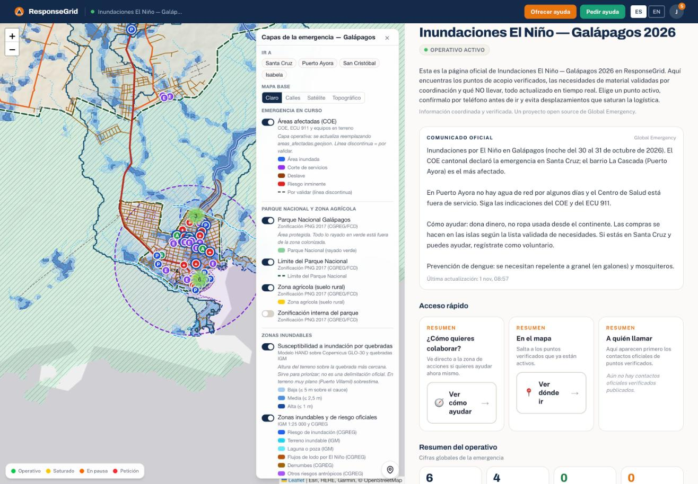

# Paquete para el equipo de ResponseGrid

Este paquete sirve para pedir a **Global Emergency / ResponseGrid** que incorpore las capas cartográficas de Galápagos al mapa público de la emergencia `galapagos-2026`.

La propuesta es **genérica**: añade a la plataforma la capacidad de mostrar **capas cartográficas por emergencia**, descritas en un manifiesto `capas.json`. Galápagos es el primer caso de uso. Una emergencia sin manifiesto no cambia en nada.

## Qué contiene

| Archivo | Para quién | Qué es |
|---|---|---|
| `01-issue-propuesto.md` | Coordinación → equipo de ResponseGrid | Texto **listo para pegar** como issue «[FEATURE]» en GitHub, siguiendo su plantilla. |
| `02-guia-tecnica.md` | Desarrolladores de ResponseGrid | Cómo funciona, archivos tocados, cómo aplicar el parche, cómo probar, cómo publicar los datos y la verificación ya pasada. |
| `capas-por-emergencia.patch` | Desarrolladores | Parche `git` contra `main` @ `d83c2e5`: 10 archivos y unas 960 líneas, todo en `apps/web` más `docs/`. |
| `codigo/` | Desarrolladores | Los mismos archivos sueltos, por si prefieren copiarlos. |
| `../datos/` | Desarrolladores | Los datos de Galápagos (13 MB): van a `apps/web/public/capas/galapagos-2026/` o a un CDN. |
| `../documentacion/` | Todos | Catálogo de capas, metodología, fuentes y licencias, especificación de `capas.json`. |

## Cómo pedirlo (pasos)

1. Abrir un issue en https://github.com/GlobalEmergency/ResponseGrid/issues/new/choose → **«Propuesta de feature»**, y pegar el contenido de `01-issue-propuesto.md`, sección por sección.
2. Adjuntar al issue, o compartir por el canal acordado con Global Emergency:
   - `capas-por-emergencia.patch`;
   - un zip de `mapas-galapagos/datos/` (13 MB);
   - las capturas `../capturas/01-puerto-ayora.jpg` y `06-responsegrid-integrado.jpg`.
3. Indicar quién es el **contacto técnico** para dudas sobre los datos: la coordinación de USFQ Galápagos.
4. Acordar con ellos **dónde se publican los datos**. Hay dos opciones:
   - **(a)** dentro del repositorio, en `apps/web/public/capas/galapagos-2026/` (13 MB);
   - **(b)** en un bucket o CDN, con `NEXT_PUBLIC_CAPAS_BASE_URL`.

   La opción (b) permite actualizar las **áreas afectadas** sin desplegar la web.
5. Acordar **quién actualiza** `areas_afectadas.geojson` durante la emergencia y por qué vía (ver `../documentacion/05-como-actualizar.md`).

> Este paquete **no** abre el issue ni sube nada por su cuenta: hay que enviarlo a mano. Según sus normas (`AGENTS.md`), los commits y PR no deben mencionar herramientas de IA.

## Estado de la verificación

Ya hecho en la copia local, con el parche aplicado sobre su `main`:

| Comprobación | Resultado |
|---|---|
| `tsc --noEmit` (web) | ✅ sin errores |
| `node --test` (web) | ✅ 125/125 (7 tests nuevos) |
| `eslint` en los archivos tocados | ✅ sin errores ni avisos |
| `next build` + `next start` | ✅ sin errores de consola en el mapa de `/e/galapagos-2026` |
| Emergencia sin manifiesto | ✅ `capas.json` responde 404 y el mapa queda solo con OSM, como antes |

Una nota: `eslint` del proyecto completo da **1 aviso que ya existía en su `main`**, en `opengraph-image.tsx`, un archivo que no se toca.
